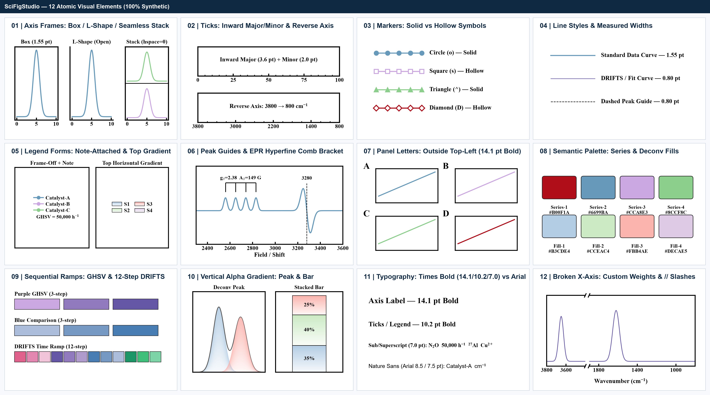
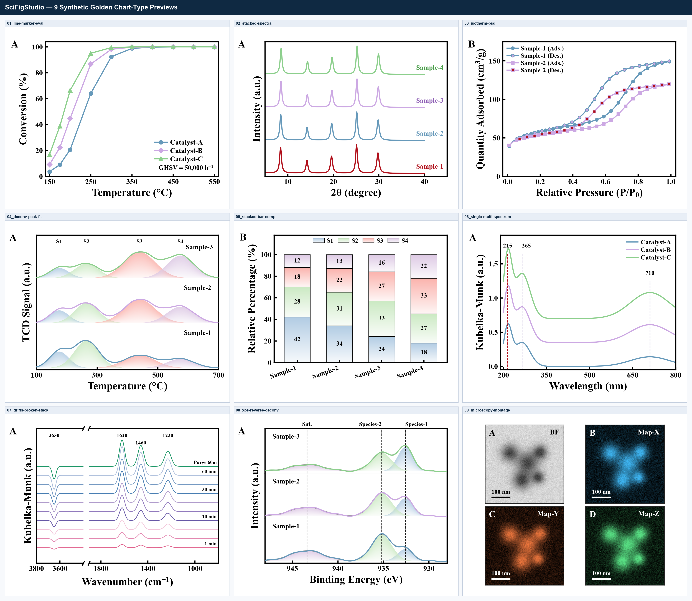

# SciFig Chemistry Charts (`scifig-chemistry-charts`)

An Origin-free, declarative scientific figure engine, 9-type chemistry chart asset library, and reusable AI agent skill (`SKILL.md` + `scifig` CLI + `blind_planner`).

> **简体中文简介**：面向化学、催化、光谱、表征与电镜拼版的**脱离 Origin 声明式科研制图工作台与 AI Skill**。内置 9 类化学图型契约与绘制 SOP、多仪器原始格式直读（`.spa` / `.VGD` / `.asc` / `.ras` / `.spc` / Bruker TopSpin / `.tif`）、定量视觉 QA 门禁，以及无需任何参考图的 **Blind / No-Reference 自动直出模式**。

---

## Features

- **Declarative JSON Spec -> Vector/Raster**: One `spec.json` renders `PNG`, `SVG`, `PDF`, `.provenance.json` (input SHA-256, column mapping, explicit `ops`), and `.qa.json`.
- **Two Workflows**:
  - **Mode 1 (Reference-Anchored)**: Extract layout/font/stroke blueprints from target vector PDFs (`render-refs`, `extract-blueprints`), map data slots, render, and verify side-by-side (`qa`, `compare`).
  - **Mode 2 (Blind / No-Reference)**: Pass only `(data_paths, chart_id, theme, caption)` to `scifig.blind_planner` for automatic column role inference, reverse-x / broken-axis detection, robust stacking, sparse-corner legend placement, and up to 3 QA auto-repair cycles.
- **9 Canonical Chemistry Chart Types (`assets/charts/`)**:
  1. `01_line-marker-eval` — Catalytic evaluation (`NOx` conversion, selectivity, byproduct concentration vs T)
  2. `02_stacked-spectra` — Stacked 1D spectra (PXRD, solid-state NMR)
  3. `03_isotherm-psd` — N₂ adsorption-desorption isotherms & `dV/dlog(W)` pore size distribution
  4. `04_deconv-peak-fit` — Seamless (`hspace=0`) stacked deconvolution with vertical-gradient fills (TPD, TPR, NMR)
  5. `05_stacked-bar-comp` — 100% stacked composition bars with vertical gradient fills & legend patches
  6. `06_single-multi-spectrum` — Unstacked multi-curve spectra with peak guides or EPR hyperfine comb brackets
  7. `07_drifts-broken-stack` — Time-resolved in situ DRIFTS stacks (auto broken-axis or unbroken bands)
  8. `08_xps-reverse-deconv` — Reverse binding-energy XPS deconvolution anchored to Shirley background
  9. `09_microscopy-montage` — Tight-gap TEM/HAADF/EDS & SEM raster montages with badges and scale bars
- **Native Instrument Readers (`scifig.readers`)**: `.csv`, `.xlsx`, `.xls`, `.txt`, `.spa` (OMNIC), `.VGD` (Thermo Avantage float64 counts), `.asc`/`.ras` (Rigaku XRD), `.spc`, Bruker TopSpin (`1r`/`procs`), and `.tif`/`.png`.

---

## Visual Asset Library (100% Synthetic Open-Source Swatches & Previews)

All visual assets below are mathematically synthesized via `python -X utf8 -m scifig.build_visual_assets` (zero copied lab data):

### 12 Atomic Visual Elements


### 9 Chemistry Chart Types


---

## Quickstart

```bash
pip install -r requirements.txt

# 1. Environment & asset diagnostics
python -X utf8 scripts/run_scifig.py doctor
python -X utf8 scripts/run_scifig.py templates

# 2. Mode 1: Render declarative spec + run QA
python -X utf8 scripts/run_scifig.py render examples/demo_spec.json -o examples/out --name Demo
python -X utf8 scripts/run_scifig.py qa examples/demo_spec.json --png examples/out/Demo.png

# 3. Mode 2: Blind / No-Reference generation from raw/tidy table
python -X utf8 scripts/run_scifig.py blind \
  --data examples/demo_eval.csv \
  --chart 01_line-marker-eval \
  --theme journal-nature-arial \
  --caption "Synthetic catalytic evaluation demo" \
  -o examples/out --name Demo_blind
```

---

## Repository Structure

```text
scifig-chemistry-charts/
├─ SKILL.md                  # AI agent skill entrypoint (Mode 1 & Mode 2)
├─ references/               # Chart workflows, typography/QA rules, instrument format specs
├─ scripts/run_scifig.py     # Cross-platform UTF-8 CLI wrapper
├─ scifig/                   # Core Python engine, readers, QA gate, blueprint extractor, blind planner
├─ assets/
│  ├─ index.json             # Asset catalog
│  ├─ themes/                # origin-times-bold, journal-nature-arial, journal-acs-serif
│  ├─ palettes/              # publication-pastel, okabe-ito, nature-npg
│  └─ charts/01_..09_/       # Per-chart chart.json (data contract + blind defaults + QA) & workflow.md
└─ examples/                 # Self-contained synthetic CSV + spec demo
```

## License

MIT License — Copyright (c) 2026 `qwe4559999`.
