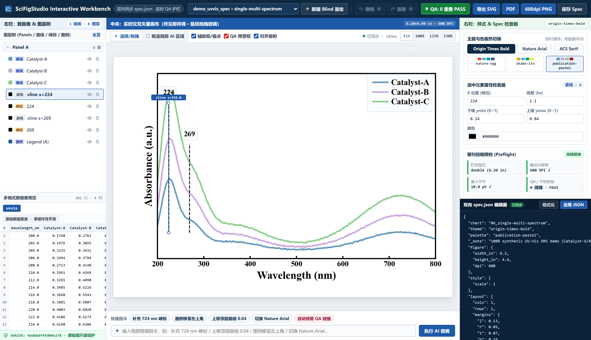
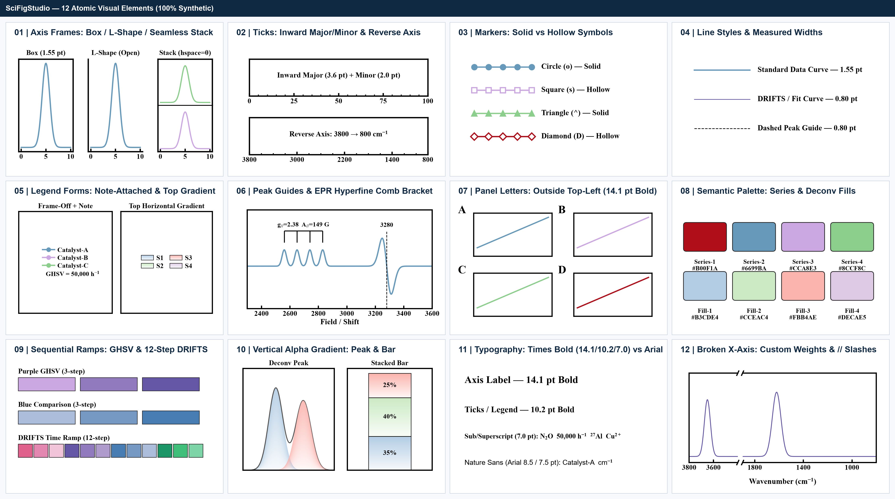
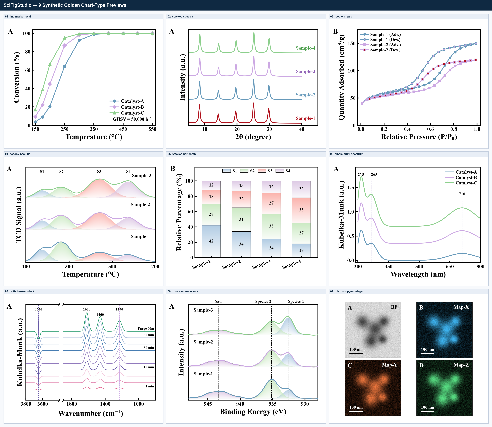

<div align="center">

# SciFig 化学科研制图与人机协同工作台 (`scifig-chemistry-charts`)

**AI Agent Skill · 声明式 CLI 引擎 · 所见即所得人机协同 GUI 工作台**

[](https://github.com/qwe4559999/scifig-chemistry-charts/releases)
[](LICENSE)
[](pyproject.toml)

[English](README.md) | **简体中文**

</div>

面向化学、催化、光谱、分峰拟合与电镜拼版的**脱离 Origin 声明式科研制图引擎（`scifig`）、9 类化学图表资产库、跨框架 AI Agent Skill（`SKILL.md`）与交互式人机协同 GUI 工作台（`scifig-workbench`）**。统一底层渲染引擎与 `spec.json` 协议，同时支持 **AI Agent 自动化复现**、**无参照盲绘（Blind Mode）**与 **浏览器端拖拽微调及实时 QA 碰撞护栏**。



*SciFigStudio 工作台内置 100% 合成 UV-Vis DRS 示例（`examples/demo_uvvis_spec.json`）：左侧为图层树与 SHA-256 原始数据溯源；中间为可拖拽矢量画布与局部 AI 微调指令栏；右侧为期刊主题/配色热切换、属性检查器、投稿预检及双向同步 `spec.json` 编辑器。*

---

## 快速安装与启动（3 种方式）

### 方式 A — 零安装桌面版 GUI（GitHub Release，推荐）

1. 前往 [**GitHub Releases**](https://github.com/qwe4559999/scifig-chemistry-charts/releases) 下载 **`SciFigStudio-Workbench-v2.1.0-win64.zip`**（macOS / Linux 下载 `SciFigStudio-Workbench-v2.1.0-<macos|linux>-portable.tar.gz`）。
2. 解压后双击 **`SciFigStudio-Workbench.exe`**（macOS / Linux 运行 `./launch_workbench.sh`）。
3. 浏览器自动打开 `http://127.0.0.1:8765/`（若端口被占用则自动顺延），内置 3 套合成化学示例可直接体验。

---

### 方式 B — 一条命令 / 一句话安装 Agent Skill *（自带完整 GUI 工作台）*

原生支持 **`SKILL.md`** 规范的五大主流框架：**Antigravity、DeepSeek Harness、Claude Code、Codex、Cursor**（同时兼容 `npx skills add qwe4559999/scifig-chemistry-charts`）。安装 Skill 后即自带 **Mode 1/2/3 全部工作流、`scifig` CLI 引擎、9 类化学图表模板与完整交互式 GUI 工作台**。

**方式一 — 一句话让 AI Agent 自动安装（复制粘贴发送给 Agent 即可）：**

> *“请将 `https://github.com/qwe4559999/scifig-chemistry-charts` 安装为本地 Skill，安装所需 Python 依赖，并运行 `doctor` 验证环境。”*

**方式二 — 终端一条命令安装：**

```powershell
# Windows PowerShell（默认安装至 Antigravity 全局目录；其余框架路径见下表）
git clone https://github.com/qwe4559999/scifig-chemistry-charts.git "$env:USERPROFILE\.gemini\antigravity\skills\scifig-chemistry-charts" && python -m pip install -r "$env:USERPROFILE\.gemini\antigravity\skills\scifig-chemistry-charts\requirements.txt" && python -X utf8 "$env:USERPROFILE\.gemini\antigravity\skills\scifig-chemistry-charts\scripts\run_scifig.py" doctor
```

```bash
# macOS / Linux（Antigravity 全局目录）
git clone https://github.com/qwe4559999/scifig-chemistry-charts.git ~/.gemini/antigravity/skills/scifig-chemistry-charts && python3 -m pip install -r ~/.gemini/antigravity/skills/scifig-chemistry-charts/requirements.txt && python3 -X utf8 ~/.gemini/antigravity/skills/scifig-chemistry-charts/scripts/run_scifig.py doctor
```

| Agent 框架 | 推荐安装路径 | 说明 |
| :--- | :--- | :--- |
| **Antigravity** | `~/.gemini/antigravity/skills/scifig-chemistry-charts` | 全局 Skill 目录，跨工作区自动加载 |
| **DeepSeek Harness / Codex / Cursor** | `.agents/skills/scifig-chemistry-charts` | 项目级或用户级 `.agents/skills/` 目录 |
| **Claude Code** | `~/.claude/skills/scifig-chemistry-charts` | 全局 `~/.claude/skills/` 或项目 `.claude/skills/` |
| **Vercel `skills` CLI** | `npx skills add qwe4559999/scifig-chemistry-charts` | 通用 `SKILL.md` 一键安装 |

安装完成后，随时可通过 `python -X utf8 <skill目录>/scripts/run_scifig.py workbench --port 8765` 启动完整 GUI 工作台（或直接双击 `launch_workbench.bat` / 运行 `./launch_workbench.sh`）。

---

### 方式 C — Python 包 / CLI 与本地 HTTP REST API

#### 1. Python 包安装与命令行快速上手

```bash
git clone https://github.com/qwe4559999/scifig-chemistry-charts.git
cd scifig-chemistry-charts
pip install -e .                 # 注册 `scifig` 与 `scifig-workbench` 命令

scifig doctor                    # 检查资产、字体与 9 类图表模板
scifig workbench --port 8765     # 启动 GUI 工作台（或运行 scifig-workbench）

# Mode 1：声明式 spec 渲染与 QA 质检
scifig render examples/demo_uvvis_spec.json -o examples/out --name DemoUV
scifig qa examples/demo_uvvis_spec.json --png examples/out/DemoUV.png

# Mode 2：原始数据无参照盲绘
scifig blind --data examples/demo_eval.csv --chart 01_line-marker-eval --theme journal-nature-arial --caption "Synthetic catalytic evaluation" -o examples/out --name Demo_blind
```

*内置 100% 合成演示（位于 `examples/`）*：`demo_uvvis_spec.json`（UV-Vis 多曲线）、`demo_spec.json`（催化评价曲线）与 `demo_drifts_spec.json`（时间分辨断轴原位 DRIFTS）。

#### 2. 无头本地 HTTP REST API（`--no-open`，供 Tool-Calling Harness 调用）

使用 `--no-open` 将工作台作为本地制图微服务启动，供 **DeepSeek、LangGraph、OpenAI Agents** 等自定义 Tool-Calling 框架调用：

```bash
scifig-workbench --no-open --port 8765
```

| 接口端点 | Agent Tool Calling 用途 |
| :--- | :--- |
| `POST /api/blind` | 传入 `(data_path, chart_id, theme, palette, title)`，调用 `blind_planner` 生成初始 `spec`、预览图与 `qa` 报告。 |
| `POST /api/render` | 渲染修改后的 `spec` 字典，返回最新 `qa` 碰撞框、可拖拽 `handles` 与 `preflight` 投稿预检结果。 |
| `POST /api/ai-command` | 通过离线 NLU 或外接大模型执行中英文局部微调指令（如 `补充 724 nm 峰标`、`图例移至左上角`）。 |
| `POST /api/auto-fix` | 运行确定性 `auto_fix_qa` 碰撞/裁切修复，返回 `actions`、`diff_lines` 与修复后 `spec`。 |
| `POST /api/export` | 导出出版级可编辑 `svg`、矢量 `pdf`、`600 DPI png`、`spec` 或 SHA-256 数据溯源清单。 |

```python
import json, urllib.request

def post_json(path, payload):
    req = urllib.request.Request(
        f"http://127.0.0.1:8765{path}",
        data=json.dumps(payload).encode("utf-8"),
        headers={"Content-Type": "application/json"},
    )
    with urllib.request.urlopen(req, timeout=30) as resp:
        raw = resp.read()
        return json.loads(raw) if "application/json" in resp.headers.get("Content-Type", "") else raw

state = post_json("/api/blind", {"data_path": "examples/demo_eval.csv", "chart_id": "01_line-marker-eval", "theme": "journal-nature-arial"})
state = post_json("/api/ai-command", {"spec": state["spec"], "instruction": "图例移至左上角"})
if not state["qa"]["pass"]:
    state = post_json("/api/auto-fix", {"spec": state["spec"]})
svg_bytes = post_json("/api/export", {"spec": state["spec"], "format": "svg", "dpi": 600})
```

#### 3. 可选接入 DeepSeek 等 OpenAI 兼容大模型（默认 100% 离线）

当未设置 `SCIFIG_LLM_API_KEY` 时，工作台 AI 指令栏默认以 **100% 离线确定性 NLU**（`engine_mode: "local_nlu"`）运行；配置以下 3 个环境变量后，未命中本地规则的复杂自然语言指令将自动路由至 DeepSeek 等 `/chat/completions` 接口：

```bash
export SCIFIG_LLM_API_KEY="sk-your-key"
export SCIFIG_LLM_BASE_URL="https://api.deepseek.com/v1"
export SCIFIG_LLM_MODEL="deepseek-chat"
scifig-workbench --port 8765
```

---

## 三大工作模式与 9 类化学图表引擎

三大模式共用同一套声明式 `spec.json` 规范、仪器直读模块（`scifig.readers`）、渲染引擎（`scifig.engine`）与视觉/数值 QA 门禁（`scifig.qa`）：

| 模式 | 核心流程 | 适用场景 |
| :--- | :--- | :--- |
| **Mode 1 — 参照复现模式** | `render-refs` → `extract-blueprints` → `probe` / `read` → `render` → `qa` / `compare` | 1:1 复现顶刊文献版式与实验室既有 PDF 模板 |
| **Mode 2 — 无参照盲绘模式** | `scifig blind` / `POST /api/blind`（`blind_planner` 最多 3 轮 QA 自动修复） | 仅提供原始表格或仪器文件时一键自动成图 |
| **Mode 3 — 交互式 GUI 工作台** | 鼠标拖拽峰标/辅助线/图例/子图编号 + AI 局部微调 + 实时 QA 红框预警 + 600 DPI 导出 | 人机协同精修微调，并与 `spec.json` 实时双向同步 |

- **9 类标准化学图表 SOP（`assets/charts/`）**：
  1. `01_line-marker-eval` — 催化活性评价（转化率、选择性、副产物浓度随温度变化）
  2. `02_stacked-spectra` — 堆叠一维谱图（PXRD、固体核磁）
  3. `03_isotherm-psd` — N₂ 吸脱附等温线与 `dV/dlog(W)` 孔径分布
  4. `04_deconv-peak-fit` — 无缝堆叠分峰拟合（`hspace=0` 垂直渐变填充，适用于 TPD、TPR、NMR）
  5. `05_stacked-bar-comp` — 100% 渐变堆叠组分柱状图
  6. `06_single-multi-spectrum` — 非堆叠多曲线光谱（含峰位标注或 EPR 超精细裂分梳状标尺）
  7. `07_drifts-broken-stack` — 时间分辨原位 DRIFTS 堆叠谱（支持自动断轴 `[3800, 3400] // [1900, 800]`）
  8. `08_xps-reverse-deconv` — XPS 高分辨反序结合能分峰（锚定 Shirley 本底）
  9. `09_microscopy-montage` — 紧边距 TEM/HAADF/EDS 与 SEM 电镜拼版（角标与比例尺）
- **原生仪器格式直读（`scifig.readers`）**：支持 `.csv`、`.xlsx`/`.xls`、`.txt`、`.spa`（OMNIC）、`.VGD`（Thermo Avantage）、`.asc`/`.ras`（Rigaku XRD）、`.spc`、Bruker TopSpin（`1r`/`procs`）及 `.tif`/`.png`。

---

## 100% 合成视觉资产库

以下图元与画廊均由 `python -X utf8 -m scifig.build_visual_assets` 数学合成，不含任何未发表实验数据：

### 12 种原子级视觉图元


### 9 类化学图表全景画廊


---

## 贡献者

<a href="https://github.com/qwe4559999/scifig-chemistry-charts/graphs/contributors">
  
</a>

## 开源协议

[MIT License](LICENSE) — Copyright (c) 2026 `qwe4559999`.
